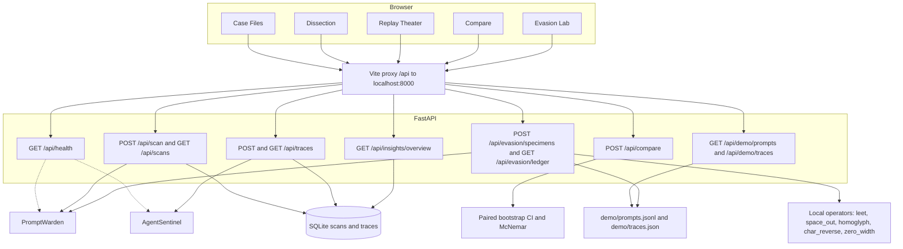
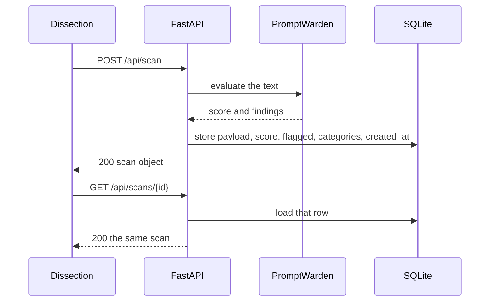

# TrustLens architecture

TrustLens is a small web product in front of three trust checks Krish already uses. The UI is an Inspection Theater: Case Files, Replay Theater, Dissection, Compare, and Evasion Lab. A person opens a case, replays a trace, dissects a prompt, compares two score lists, or lays a mutated prompt on the bench. The numbers on screen come from the API. The API's numbers come from PromptWarden, AgentSentinel, the comparison routine that lives in the server, or a live scan of mutated demo prompts. The five mutation operators are implemented in `server/app/mutations.py` under TrustBreaker's names. These operators require only the Python standard library.

`SPEC.md` is the contract. This note is how the pieces connect. It does not add endpoints or fields.

## Who owns which directory

| Path | Role |
| --- | --- |
| `server/` | FastAPI app (`app.main:app`), SQLite, pytest, ruff |
| `web/` | React + Vite + TypeScript + Tailwind. Charts with Recharts |
| `demo/` | Demo prompts and traces, plus that area's loader notes |
| `docs/` | This note, the screenshot plan, the local runbook |
| `contract-tests/` | Black-box API tests written from the spec |
| `SPEC.md` | Read-only contract |

## How a request moves

The browser talks only to the Vite dev server. Vite proxies `/api` to `http://localhost:8000`. The FastAPI process owns scoring, storage, and the demo files. PromptWarden and AgentSentinel are imported libraries. The paired comparison does not call out to the PromptRegress package; the spec puts that math in the server, stdlib only, using PromptRegress's method.

The dotted health arrows are import checks. `engines.promptwarden` and `engines.agentsentinel` are true when that import succeeds. The comparison routine is local code, so it has no flag in `engines`.

A prompt scan, then a reload of that same row:

The engine call in that diagram is the data flow. The spec does not publish PromptWarden's function names. The HTTP body is the contract the UI can rely on.

## Engines

| Check | Implementation | API | What the UI shows |
| --- | --- | --- | --- |
| Prompt injection and PII | PromptWarden, pip-installed from its GitHub repo | `POST /api/scan` | Dissection: clause marks, evidence, score in 0..1, flagged badge, categories, signals |
| Agent trace | AgentSentinel, pip-installed from its GitHub repo | `POST /api/traces` | Replay Theater: score, flagged, categories, signals, per-step risk, playback that stops on the first dangerous step |
| Paired comparison | Server code, stdlib only. Paired bootstrap 95% CI on the mean difference, 10,000 resamples, seed 13. McNemar's exact test | `POST /api/compare` | Means, difference, CI, McNemar p, gate |

A comparison **case passes** when its score is **≥ 0.5**. The spec considers and then drops a different rule (`score > 0` unless the case is strictly 0/1). The gate does not follow the p-value. The gate is **FAIL** when the CI upper bound is **< 0** (candidate worse) and **PASS** otherwise, including a CI that touches zero or sits entirely above zero.

That "candidate worse" clause is what fixes the sign of `mean_diff`: negative means the candidate mean is below the baseline mean. The spec does not write the subtraction on its own line. `contract-tests/` locks `mean_diff = candidate_mean - baseline_mean` for that reason, and says so next to the assertion.

Per-step `risk` is a float in 0..1. SPEC.md now fixes the derivation: rule weights attach to the steps whose content fired the rule, and classifier tool-name features do not copy the whole-trace score onto every step that shares that tool. Every input step is returned, with a zero-based index. A step with no local evidence has risk 0. Replay Theater pauses on the first step at or above 0.5. The contract tests check the annotation fields and the risk range.

Scan `flagged` and trace `flagged` are booleans in the response. The spec does not define them as `score >= 0.5`. That threshold belongs to comparison cases. The UI shows the boolean the API returns.

## API surface

All bodies are JSON. Prefix `/api`.

| Method and path | Success | Failure the spec names |
| --- | --- | --- |
| `GET /api/health` | `{"ok": true, "engines": {"promptwarden": bool, "agentsentinel": bool}}` | — |
| `POST /api/scan` | 200 scan: `id`, `text`, `score` in 0..1, `flagged`, `categories`, `signals`, `created_at`, `kind` (`case` or `clause`), `parent_id` | 422 when `text` is empty or whitespace, or when `parent_id` is a clause. 404 when `parent_id` is not a stored scan |
| `GET /api/scans?limit=50` | `{"items": [scan, ...]}` newest first | — |
| `GET /api/scans/{id}` | One scan | 404 |
| `POST /api/traces` | 200 trace, including annotated `steps` | 422 when `trace` is not an object or `steps` is not a list |
| `GET /api/traces?limit=50` | Same list pattern as scans, items are traces | — |
| `GET /api/traces/{id}` | One trace | 404 |
| `POST /api/compare` | 200 with `n`, means, `mean_diff`, `ci_low`, `ci_high`, `mcnemar_p`, `gate` of `PASS` or `FAIL` | 422 on mismatched lengths, length under 2, or a non-finite value |
| `GET /api/insights/overview` | Totals, category counts, trend. Empty stored data is zeros and empty lists | Never an error just because the tables are empty |
| `GET /api/demo/prompts` | The demo prompt set | Missing file: empty list |
| `GET /api/demo/traces` | The demo trace set, each object plus `label` | Missing file: empty list |
| `POST /api/evasion/specimens` | Original scan plus one variant per operator (`leet`, `space_out`, `homoglyph`, `char_reverse`, `zero_width`), each with score, flagged, and `slipped` | 422 when `text` is empty or whitespace |
| `GET /api/evasion/ledger` | Demo-set totals for prompts, originals flagged, variants generated, variants from flagged originals, bypasses, and bypass rates, with operator breakdowns | Missing demo file: zeros and a null rate |

`POST /api/scan` is the one singular create path. The collection and the by-id read are `/api/scans`. Traces use `/api/traces` for create, list, and by-id.

Compare requests in the spec include `"alpha": 0.05`. The written method is a 95% interval. The spec does not say what a different alpha does.

Demo responses are lists. The spec's phrase is "empty lists", including when the files are absent. Prompt rows are JSONL objects `{"text", "label", "category"}`. Trace rows are full trace objects (`trace_id`, `steps` of `tool` / `args` / `result`) plus `label`.

## Persistence

One SQLite file, `server/trustlens.db`, overridable with `TRUSTLENS_DB`. The tables are `scans` and `traces`. Each row keeps the payload JSON and the extracted score, flagged flag, categories, and `created_at`. A scan row also stores `kind` (`case` or `clause`), `parent_id`, and the submitted text. `GET /api/scans/{id}` returns that text. The file is created on startup, and an existing file gains the new scan columns in place. There is no migration framework. Connections use WAL and a 5 second busy timeout. A lock that outlasts the wait is `503 {"detail": "Database is locked"}`. Any other database failure is `500 {"detail": "Database error"}`. Both are JSON.

Compare results are not given a table. Insights are computed from stored trace rows and from **case** scans. Clause rows are the scored sentences of a dissection, so they are left out of the case list and out of the overview counts.

The spec does not say whether a relative `TRUSTLENS_DB` or the default path is resolved from the repository root or from the process working directory. The runbook recommends an absolute path. See `docs/integration-checklist.md`.

## UI

The shell is the Inspection Theater: left nav, the name **TrustLens**, a theme toggle, and a loading state plus an error state on every page. Dark is pure black (`#000000`). Light is pure white (`#ffffff`). The default is dark. The dev server's API base is the Vite proxy, so page code calls `/api/...` and the browser stays on the Vite origin.

| Page | Route | What it calls | What it shows |
| --- | --- | --- | --- |
| Case Files | `/` | `GET /api/insights/overview`, the scan and trace lists, `GET /api/demo/prompts`, `GET /api/demo/traces` | A slim totals strip (case-scan and trace counts, flagged counts, category counts), an intake block, one-click demo cases, and stored cases that each lead with a one-line story. Clause rows are not cases. |
| Dissection | `/scan` | `POST /api/scan`, `GET /api/scans`, `GET /api/scans/{id}`, `GET /api/demo/prompts` | The prompt split into clauses, each clause scored under the case scan so the risky sentence is marked, a verdict (score, flagged badge, categories, signals), an evidence panel, and past dissections. Reopening uses the prompt text on the scan detail and does not insert the clauses again. |
| Replay Theater | `/traces` | `POST /api/traces`, the trace list and by-id reads, `GET /api/demo/traces` | Play/pause replay, a data-flow ribbon from the submitted arguments, a risk meter, per-step risk and signals, and an incident card. Playback auto-pauses on the first step whose own risk is at least 0.5 |
| Compare | `/compare` | `POST /api/compare` | Two score lists (comma or newline separated, or a built-in example pair), stat cards, a PASS/FAIL gate badge, and a paired-difference chart |
| Evasion Lab | `/evasion` | `POST /api/evasion/specimens`, `GET /api/evasion/ledger`, `GET /api/demo/prompts` | The original specimen beside five mutated cards, each stamped caught or slipped past, and a ledger of demo-set bypass totals |

The Compare example pair is labeled example input and lives in the UI. The API section defines demo endpoints only for prompts and traces. There is no compare file and no compare demo route in the contract. The numbers on the page are the `POST /api/compare` response.

`trend` on `GET /api/insights/overview` is a list of `{date, scans, traces, flagged}`. The spec does not fix that list's length. An empty database returns an empty list, not fourteen zero days. Case Files does not chart `trend` or the average scores. The strip uses totals, flagged counts, and category counts.

The nav labels are Case Files, Replay Theater, Dissection, Compare, and Evasion Lab. The routes are the ones in the table.

The ledger scans every shipped demo prompt and its five variants on request. A bypass counts when a flagged original produces a clear variant. The bypass rate uses variants of flagged originals as its denominator. The PromptWarden and TrustBreaker READMEs report their corpus benchmarks separately.

## Configuration

| Variable or setting | Who reads it | Meaning |
| --- | --- | --- |
| `TRUSTLENS_DB` | Server | SQLite file. Default location named by the spec: `server/trustlens.db` |
| `TRUSTLENS_BASE_URL` | `contract-tests/` only | Origin of a running API. Default `http://localhost:8000` |
| Vite proxy `/api` → `:8000` | Dev server | Required by the spec so the UI and the API meet |
| Listen port 8000 | Server | The origin the proxy and the contract tests use |

The spec does not set the Vite port. Vite prints the URL it bound. The API port in the contract is 8000.
